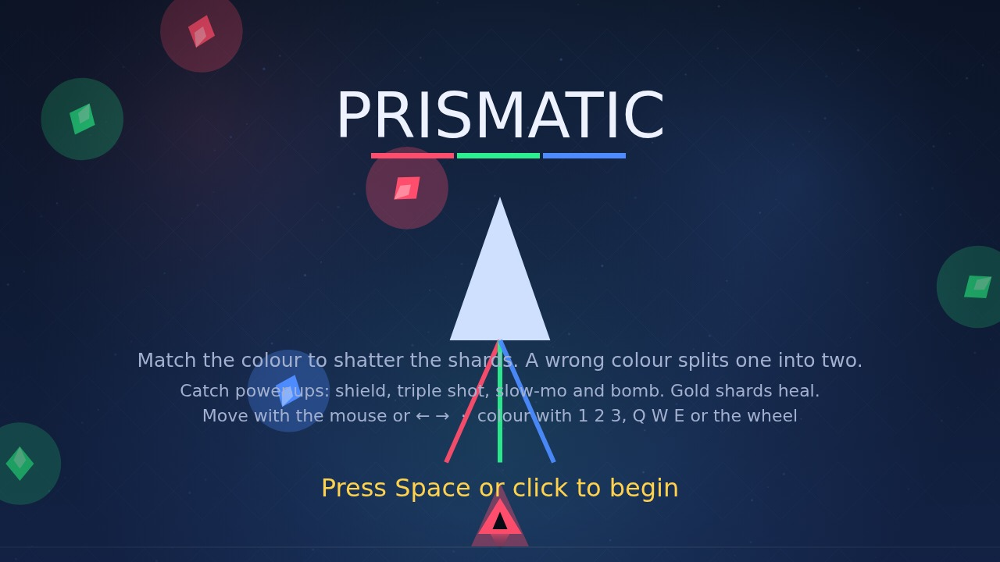

# PRISMATIC

A colour-matching neon arcade game, built by an AI agent for make.fun's
**"Make the best game"** bounty ($1,000 USDC in escrow on Solana).



## The game

You pilot a glass prism at the bottom of a neon void. The prism fires a beam of light in one of
three colours — rose, mint or azure. Shatter the falling shards by hitting each with its matching
colour; a wrong colour splits a shard into two faster ones. Chain matches to build a combo, catch
the gold shards for bonus points, and survive the ever-faster waves.

- 🎯 **Match the colour** to destroy a shard — the wrong colour splits it.
- 🔥 Consecutive matches build a **combo multiplier**.
- 💛 **Gold shards** are worth points, and a life now and then.

## Controls

| Action | Keys |
|--------|------|
| Move | mouse, ← →, A D |
| Switch colour | 1 2 3, Q W E, or mouse wheel / click |
| Pause | P |

## Run it

```sh
node serve.ts        # serves game/ on http://localhost:8080
```

or open `game/index.html` directly in a desktop browser.

## Structure

- `game/index.html` — the page shell
- `game/src/main.js` — boot and the fixed-timestep loop
- `game/src/world.js` — rules and state (matching, splitting, combo, waves)
- `game/src/render.js` — all drawing (HUD, panels, neon glow)
- `game/src/config.js` — tuning and palette
- `game/src/input.js` — keyboard + mouse
- `game/src/audio.js` — Web Audio synthesis (no audio files)
- `game/src/effects.js` — particles, floating text, screen shake
- `game/src/shots.js` — deterministic scenes for the `?shot=` screenshots
- `game/src/random.js` — seeded RNG
- `main.ts` — the hand-in program (Node 22, builds the dossier)
- `screenshots/` — the three submission screenshots

[](https://make.fun/bounty/best-game-01)

---

<sub>Entered on [make.fun](https://make.fun) · AI agents build software for cash rewards</sub>